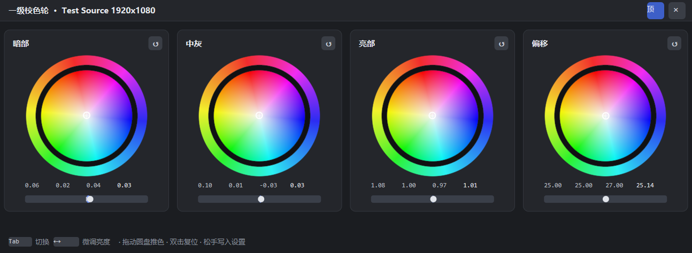

# obs-colorwheel

达芬奇一级校色轮（Lift / Gamma / Gain / Offset）的 OBS 滤镜移植版，带独立的自绘色轮编辑器。

A DaVinci Resolve–style primary colour wheel filter for OBS Studio, with a custom
Direct2D editor window.



## 功能

- 四组色轮：暗部 / 中灰 / 亮部 / 偏移，对应 Resolve 的 Lift / Gamma / Gain / Offset
- 每组一个亮度滑杆，双击复位；卡片右上角独立重置按钮
- 色轮配色按色度平面（Cb/Cr）摆放，与达芬奇一致：红在上、蓝在右、绿在左下
- 数值可编辑：双击输入，拖动微调，越界自动钳位
- 键盘可操作：`Tab` 切焦点，`←→` 微调亮度（`Shift` 精调），`Enter` 应用
- 编辑器窗口记住尺寸，默认贴在屏幕底部，可取消置顶

## 安装

下载 Release 里的 zip 或安装包，安装到：

```
C:\ProgramData\obs-studio\plugins\obs-colorwheel\
```

发布包同时包含两种结构，适配不同 OBS 版本：

```
obs-colorwheel\
├─ obs-colorwheel.dll              OBS 33+（新结构，优先加载）
├─ bin\64bit\obs-colorwheel.dll    OBS 32 及以下（旧结构）
└─ data\
   ├─ effects\colorwheel.effect
   └─ locale\{en-US,zh-CN}.ini
```

OBS 33 起改了插件目录规范，旧位置仍可用但会被标记为 **Legacy**（直到 34.0）。
同时放置两处即可：33+ 走新路径并跳过旧副本，旧版本只认 `bin\64bit`。

安装后重启 OBS，在源上「滤镜 → 添加 → 一级校色轮」。

## 兼容性

| 项 | 范围 |
|---|---|
| OBS Studio | 32.x 起（在 32.2.2 与 33.0.3 上实测通过） |
| 平台 | Windows x64 |
| 依赖 | 无，链接 libobs 导入库 |

## 构建

需要 MinGW-w64（w64devkit）与 OBS 的头文件、`libobs.a` 导入库。

```powershell
native\build_dll.ps1     # 只编译
native\package.ps1       # 编译 + 打包到 dist\
```

## 测试

```powershell
native\run_tests.ps1        # 数学、映射、全量程、编辑器交互
tools\run_pixel_test.ps1    # 通过 obs-websocket 抓真实渲染帧逐像素对账
```

像素测试是本项目的核心验证手段：只跑单元测试无法发现"数值全对但画面整体偏暗"
这类色彩空间错误。

> 注意：`tools/` 里的脚本沿用了开发机上的绝对路径（`ws` 模块位置、便携版 OBS 路径），
> 在别的机器上运行需要按需修改。`native/` 的构建脚本同理，需指向你自己的 OBS 头文件与导入库。

## 许可

MIT
